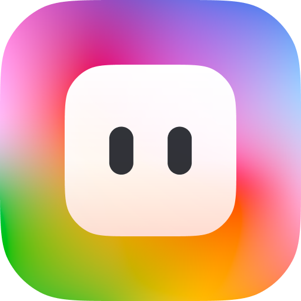

<p align="center">
  
</p>

<h1 align="center">Iconaut icons</h1>

<p align="center"><b>The 3,000+ icon library. Sharp at every size.</b></p>

<p align="center">
  <a href="https://www.npmjs.com/package/iconaut-react"></a>
  <a href="https://www.npmjs.com/package/iconaut-react"></a>
  <a href="LICENSE"></a>
  <a href="https://www.figma.com/community/plugin/1654947060820411920"></a>
</p>

1,680 free icons in **line, solid and duotone**, drawn on one 24px grid, with a real
drawing at every native size. MIT licensed, with zero dependencies.

**[Browse them](https://iconaut.design/icons)** · [iconaut.design](https://iconaut.design) · for [React](#install),
[React Native](#react-native), [AI agents](#ai-coding-agents-mcp), [Figma](#use-it-in-figma) and plain SVG

<picture>
  <source media="(prefers-color-scheme: dark)" srcset=".github/preview-dark.svg">
  
</picture>

## Install

```bash
npm i iconaut-react
```

```jsx
import { Rocket, RocketSolid, RocketDuo } from "iconaut-react";

<Rocket />                    // the 24px fit
<Rocket size={16} />          // the REAL 16px drawing, not the 24px one scaled down
<Rocket strokeWidth={1.25} /> // override the fit's optical stroke
<Rocket className="text-blue-500" />
```

**Zero dependencies.** `iconaut-react` installs nothing but itself: `react` (>=17) is a peer
dependency, so your app's own copy is used. The same goes for `@iconaut/react-native` (peers: `react` and
`react-native-svg`) and `@iconaut/mcp` (Node's standard library only).

Or take the SVGs: they are plain files with no wrapper, and every path takes
`currentColor`, so an icon inherits whatever text colour is in scope. Every file is on the
jsDelivr CDN straight from this repository:

```html

```

### shadcn/ui

`iconaut-react/shadcn` exports the icons under the lucide names shadcn/ui components import
(`CheckIcon`, `ChevronDownIcon`, `XIcon`...), and every icon is also an item in the
[shadcn registry directory](https://ui.shadcn.com/docs/directory) as `@iconaut`:

```bash
npx shadcn@latest add @iconaut/rocket
```

### React Native

The same icons as React Native components, drawn with
[react-native-svg](https://github.com/software-mansion/react-native-svg), in Expo and bare
React Native alike:

```bash
npx expo install @iconaut/react-native react-native-svg   # Expo
npm i @iconaut/react-native react-native-svg              # bare React Native
```

```jsx
import Rocket from "@iconaut/react-native/rocket";
import RocketDuo from "@iconaut/react-native/rocket-duo";

<Rocket />                                // the 24px fit, in black
<Rocket size={16} color="#1D7FF1" />      // the real 16px drawing
<RocketDuo secondaryColor="#1D7FF1" secondaryOpacity={0.3} />
```

Import each icon from its own path: Metro doesn't drop unused exports, so importing from the
package root bundles the whole set. Every icon is also at `@iconaut/react-native/icons/rocket`, the
same folder lucide-react-native uses. Set `color`, since React Native has no inherited text
colour and icons default to black. Per-icon paths need Metro's package exports support
(React Native 0.79 / Expo SDK 53 and later).

### AI coding agents (MCP)

An [MCP](https://modelcontextprotocol.io) server lets Claude Code, Cursor and other agents look
an icon up instead of guessing its name. It searches the free set and returns the SVG at the
size you ask for, the `iconaut-react` import and the shadcn/ui command. It runs locally from
data in the package: no account, no API key.

```bash
claude mcp add iconaut -- npx -y @iconaut/mcp
```

Other clients take the same command in their MCP config:

```json
{
  "mcpServers": {
    "iconaut": { "command": "npx", "args": ["-y", "@iconaut/mcp"] }
  }
}
```

[`skills/iconaut-icons/SKILL.md`](skills/iconaut-icons/SKILL.md) is an agent skill to go with
it: when to reach for the tools, which size and style to ask for, and how to use the result in
React, shadcn/ui, React Native or plain SVG. In Claude Code, copy it into `.claude/skills/`.

## Use it in Figma

- **[The free library file](https://www.figma.com/community/file/1687034537485391013)**: every free icon as a Figma component, in line,
  solid and duotone, at 16, 20 and 24px, with round and sharp corners. Because each icon is one
  shape, swapping one component for another keeps the colour you set on it.
- **[The plugin](https://www.figma.com/community/plugin/1654947060820411920)**: search by meaning, set the style, size, stroke and duo tint
  before you insert, and browse the Pro packs.

## What is in here

| Path | What |
|------|------|
| `icons/<category>/<name>/<size>/{line,solid,duo}.svg` | Every icon, at its three native fits. |
| `data/icons.json` | Names, categories, keywords, and the per-size stroke tokens. |
| `packages/react/` | The generated `iconaut-react` package. |

## A real drawing at every size

Most icon sets ship one drawing and scale it, so a 16px icon is a 24px icon with detail too
fine to read. These are authored as **native fits**: each of 16 / 20 / 24 has
its own stroke token, and at 16px a simplified *compact* drawing takes over on the icons that
carry fine detail.

| size | tier | stroke |
|---|---|---|
| 16 | compact | 1.25 |
| 20 | default | 1.5 |
| 24 | default | 1.75 |

## One shape per icon

Each icon is one closed vector shape. `line` strokes it; `solid` fills the same shape, so it
registers exactly under the line; `duo` fills it at 25% and strokes it on top. That is also
what makes them swap-safe in Figma: swapping a component keeps the colours you set on it.

## 1,680 free, and the rest

These 1,680 icons, in 27 categories, are free under MIT and stay that way — a
category that shipped free never becomes paid. The specialised Pro packs are not in this
repository; they ship in the [Figma plugin](https://www.figma.com/community/plugin/1654947060820411920) and are licensed separately
(see https://iconaut.design/terms).

## Requests and contributions

Icon requests are welcome: [post one in Discussions](https://github.com/iconaut-design/icons/discussions/categories/icon-requests) and say what you need and where
you would use it. Please read [CONTRIBUTING.md](CONTRIBUTING.md) before opening a pull
request: **this repository is generated**, so a patch to a file here cannot be merged.

## Sponsor

If Iconaut saves you time, [sponsor it on GitHub](https://github.com/sponsors/iconaut-design). Sponsorship pays for new
free icons, redraws, and keeping the React package and the Figma library current.

## License

[MIT](LICENSE). Use them in personal and commercial work, modify them, ship them in a
product. Attribution is appreciated and never required.

---
Generated from the Iconaut source of truth. Do not hand-edit; see CONTRIBUTING.md.
